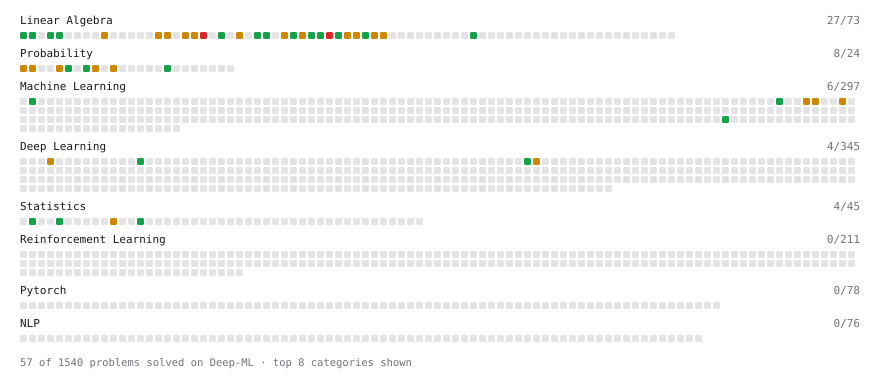

# Deep-ML

My machine learning practice from [Deep-ML](https://www.deep-ml.com). Every solution here was written by hand.

**1** solved · 0 problems · 1 labs · 0 math

[**Browse the interactive portfolio**](https://Cher-Li.github.io/deep-ml/) to replay this filling in over time.

## Labs

| | Difficulty | Solved | |
| --- | --- | --- | --- |
| [Dimensionality Reduction with Sklearn](https://www.deep-ml.com/labs/15) | easy | 2026-10-13 | [solution](labs/0015-dimensionality-reduction-with-sklearn) |

---

_This file is regenerated by Deep-ML on every push._
